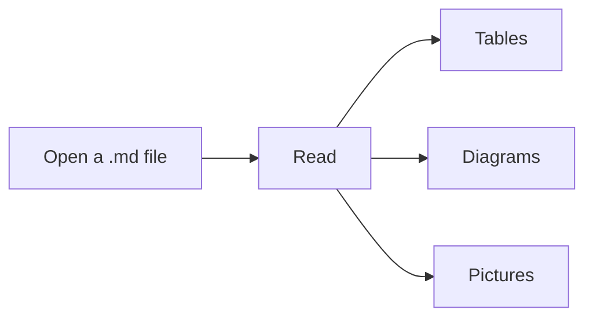
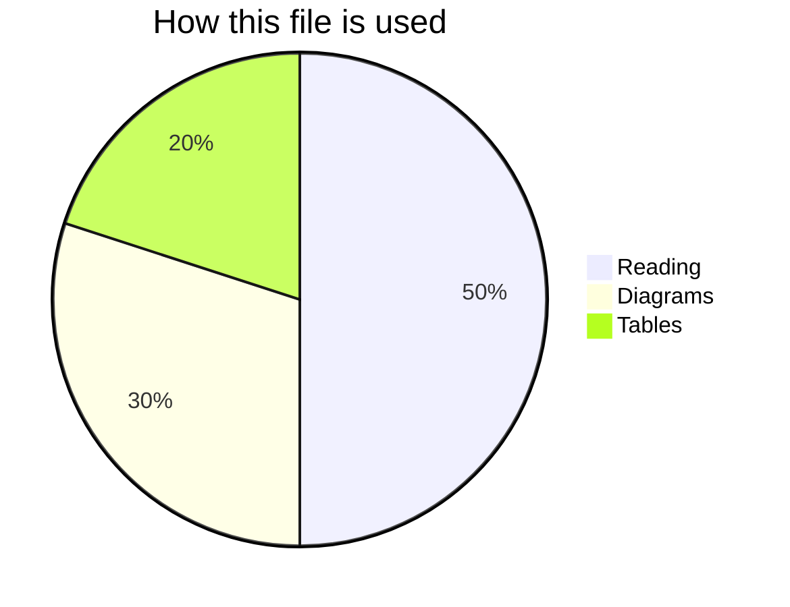
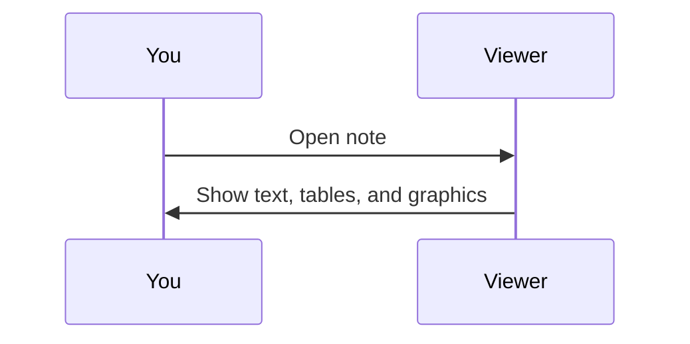
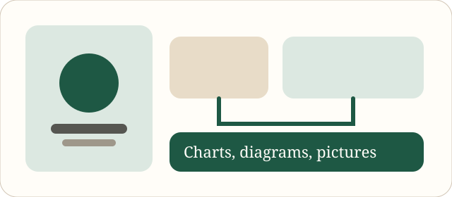

# Welcome

Open a Markdown file to read it. Pinch to zoom. Use **Contents** to jump around.

This viewer renders tables, pictures, and diagrams in the file. It does not edit them.

## Flow

## Mix

## Conversation

## Picture

## Status

| Feature | Status |
| --- | --- |
| View | Ready |
| Zoom | Ready |
| Tables | Ready |
| Diagrams | Ready |
| Pictures | Ready |
